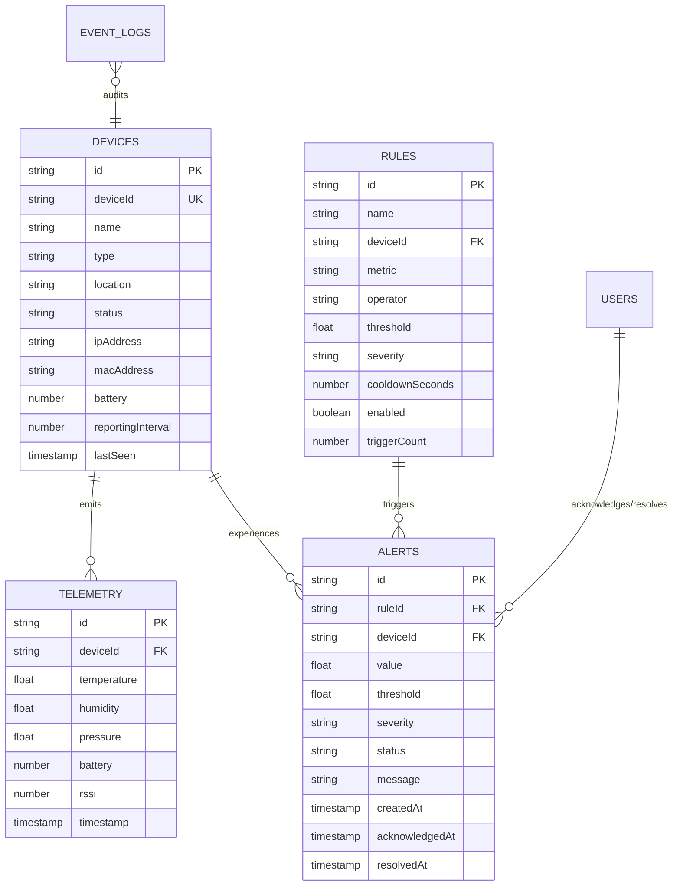

# NexusFlow — Database Schema & Data Dictionary
**Author:** Koneti Manikanth (Backend Role — Ref: ITS/WEB/1849)  
**Milestone:** Week 1 Deliverable — Schema Architecture & Persistence Modeling  

---

## 1. Storage Architecture Overview
NexusFlow implements a multi-collection persistence engine designed for high-frequency IoT telemetry logging. The persistence engine supports zero-dependency local JSON state persistence with seamless fallback and plug-and-play MongoDB schema compatibility.

---

## 2. Retention Policies & Performance Tuning
- **Circular Telemetry Buffer:** Maximum 2,000 recent measurements maintained in active memory/file buffer for ultra-fast query latency ($< 3\text{ ms}$).
- **Audit Logs Ring Buffer:** Maximum 1,000 event log entries retained.
- **Debounce Indexing:** Key-value mapping `(ruleId + deviceId) -> lastTriggeredTimestamp` ensuring zero duplicate alert spam during consecutive anomalous readings.
