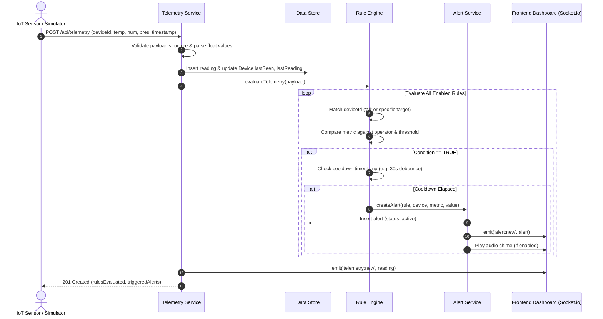

# NexusFlow — System Architecture & Technical Specifications

**Project Name:** NexusFlow: Visual IoT Telemetry & Rule Engine  
**Organization:** Infotact Solutions  
**Candidate:** Koneti Manikanth (Ref. No.: ITS/WEB/1849)  
**Role:** Associate L1. Intern — Web Development Domain  
**Duration:** 10 November 2026 – 10 December 2026  

---

## 1. High-Level Architecture Overview

NexusFlow is architected as an asynchronous, event-driven, full-stack IoT telemetry and rule evaluation platform. It ingests high-frequency sensor readings, verifies conditions across custom mathematical rules, broadcasts live updates via WebSockets, and renders analytical visual dashboards in real time.

```mermaid
flowchart TD
    subgraph IoT_Layer ["1. IoT Sensor Layer"]
        S1["Sensor 001: Assembly Line Probe"]
        S2["Sensor 002: Server Room HVAC"]
        S3["Sensor 003: Boiler High-Temp Sensor"]
        S4["Sensor 004: Cleanroom Microclimate"]
        S5["Sensor 005: Cold Storage Probe"]
        Sim["Built-in IoT Simulator (Jitter & Anomaly Injection)"]
    end

    subgraph Ingestion_Layer ["2. Data Ingestion & API Gateway"]
        REST["REST API Gateway (Express.js)"]
        WS["WebSocket Server (Socket.io)"]
        MQTT_Adapter["MQTT Broker Adapter (Optional LoRaWAN)"]
    end

    subgraph Core_Engine ["3. Core Processing & Rule Engine"]
        Validator["Telemetry Ingestion & Schema Validator"]
        RuleEngine["Rule Engine Evaluator (>, <, >=, <=, ==, !=)"]
        Cooldown["Cooldown & Debounce Controller"]
        AlertService["Alert Management & Lifecycle Dispatcher"]
        AuditLogger["System Activity & Event Auditor"]
    end

    subgraph Data_Layer ["4. Persistence & Storage Layer"]
        DB[(NexusFlow Data Store / JSON & MongoDB)]
        DevStore["Devices Collection"]
        TelStore["Telemetry Stream Buffer (2000 points)"]
        RuleStore["Configured Rules"]
        AlertStore["Active & Resolved Incidents"]
        LogStore["Event Logs"]
    end

    subgraph Presentation_Layer ["5. Visual Dashboard & UI (React.js)"]
        UI_Dash["Module 1: Dashboard (KPIs & Live Gauges)"]
        UI_Dev["Module 2: Device Management"]
        UI_Tel["Module 3: Telemetry Stream & Manual Ingest"]
        UI_Rules["Module 4: Rule Engine Visual Builder & Sandbox"]
        UI_Alerts["Module 5: Alert Lifecycle & Audio Chimes"]
        UI_Analytics["Module 6: Visual Analytics & Historical Trends"]
        UI_Logs["Module 7: Audit Event Logs"]
        UI_Settings["Module 8: System Settings & Diagnostics"]
    end

    IoT_Layer -->|HTTP POST / Telemetry| Ingestion_Layer
    Ingestion_Layer --> Core_Engine
    Core_Engine --> Data_Layer
    Core_Engine -->|Real-time Socket.io Push| Presentation_Layer
    Data_Layer -.->|Query APIs| Presentation_Layer
```

---

## 2. Ingestion & Rule Evaluation Pipeline

Every packet entering NexusFlow follows a rigorous 6-step lifecycle:

---

## 3. Database Schema Models

### 3.1 Device Schema
| Field | Type | Description |
|---|---|---|
| `id` | String (UUID) | Unique internal ID |
| `deviceId` | String | Hardware identifier (e.g. `SENSOR_001`) |
| `name` | String | Human readable device name |
| `type` | String | Category (Environmental, HVAC, Industrial, etc.) |
| `location` | String | Physical deployment location |
| `status` | String | Connection health: `online`, `warning`, `offline` |
| `ipAddress` | String | Assigned network IP |
| `macAddress` | String | Hardware MAC address |
| `battery` | Number | Battery percentage (0-100%) |
| `reportingInterval` | Number | Telemetry reporting interval in seconds |
| `lastReading` | Object | Last recorded telemetry metrics snapshot |
| `lastSeen` | ISO Timestamp | Last active communication timestamp |

### 3.2 Telemetry Schema
| Field | Type | Description |
|---|---|---|
| `id` | String (UUID) | Unique measurement entry ID |
| `deviceId` | String | Target sensor identifier |
| `temperature` | Number (Float) | Ambient temperature in Celsius (°C) |
| `humidity` | Number (Float) | Relative humidity percentage (%) |
| `pressure` | Number (Float) | Atmospheric pressure in hectopascals (hPa) |
| `battery` | Number | Remaining battery level (%) |
| `rssi` | Number | Received signal strength indicator (dBm) |
| `timestamp` | ISO Timestamp | Exact timestamp of sensor capture |

### 3.3 Rule Schema
| Field | Type | Description |
|---|---|---|
| `id` | String | Unique rule identifier (e.g. `rule_001`) |
| `name` | String | Descriptive rule name |
| `description` | String | Rule objective description |
| `deviceId` | String | Scope: `all` or specific target device |
| `metric` | String | Monitored key (`temperature`, `humidity`, `pressure`, `battery`) |
| `operator` | String | Comparison operator (`>`, `<`, `>=`, `<=`, `==`, `!=`) |
| `threshold` | Number | Numeric boundary condition |
| `actionType` | String | Action to execute: `alert`, `log` |
| `severity` | String | Alert priority: `critical`, `warning`, `info` |
| `messageTemplate`| String | Interpolated text template (supports `{{value}}`, `{{threshold}}`, etc.) |
| `cooldownSeconds`| Number | Cooldown window to prevent alert flooding |
| `enabled` | Boolean | Active evaluation flag |
| `triggerCount` | Number | Total times condition evaluated to TRUE |
| `lastTriggered` | ISO Timestamp | Timestamp of most recent breach |

### 3.4 Alert Schema
| Field | Type | Description |
|---|---|---|
| `id` | String | Unique alert ID (e.g. `alt_001`) |
| `ruleId` | String | ID of the triggering rule |
| `ruleName` | String | Name of the triggering rule |
| `deviceId` | String | Device experiencing threshold breach |
| `metric` | String | Breached metric |
| `value` | Number | Actual value that breached condition |
| `threshold` | Number | Configured threshold |
| `operator` | String | Comparison operator |
| `severity` | String | `critical`, `warning`, `info` |
| `message` | String | Human readable formatted alert message |
| `status` | String | Incident state: `active`, `acknowledged`, `resolved` |
| `acknowledgedBy`| String | User who acknowledged the incident |
| `acknowledgedAt`| ISO Timestamp | Time of acknowledgment |
| `resolvedBy` | String | User who marked resolution |
| `resolvedAt` | ISO Timestamp | Time of resolution |
| `resolutionNote`| String | Remediation explanation |

---

## 4. Technology Stack Justification

1. **Frontend: React.js + Tailwind CSS**
   - Single Page Application (SPA) with lightning-fast component re-rendering.
   - Glassmorphic industrial UI aesthetic with high-contrast metric dials.
   - Recharts library for responsive time-series vector graphing.
2. **Backend: Node.js + Express.js**
   - High-throughput asynchronous event loop ideal for concurrent IoT packet ingestion.
   - Socket.io for low-latency bidirectional real-time communication.
3. **Storage Engine: Dual-Mode Persistence**
   - Multi-collection embedded JSON file store with zero external database dependencies.
   - Guaranteed immediate execution without requiring local MongoDB daemon services.
4. **Simulator: Physical Simulation Engine**
   - Realistic multi-device sine-wave and random-walk environmental emulation.
   - Instant anomaly injection trigger for live demonstrations.
